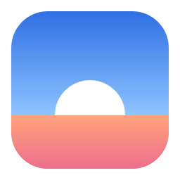
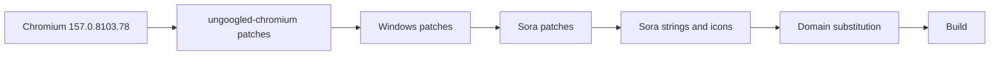

<div align="center">
  

  <h1>Sora Browser</h1>

  <p><strong>Zen Browser's interface on the Chromium engine, without Google's services.</strong></p>

  <p>
    <a href="https://github.com/jpcerchiari/sora-browser/actions/workflows/build-x64.yml"></a>
    
    
    
    <a href="LICENSE"></a>
  </p>

  <p>
    <a href="#features">Features</a> ·
    <a href="#building">Building</a> ·
    <a href="roadmap/README.md">Roadmap</a> ·
    <a href="#contributing">Contributing</a>
  </p>

  <p><strong>English</strong> · <a href="README.pt-BR.md">Português</a></p>
</div>

> [!IMPORTANT]
> Sora is in **pre-alpha**. Every patch applies cleanly to Chromium 157.0.8103.78, but the
> project has not been compiled yet and there are no releases. For now, the repository is for
> following development, not for daily use.

## Table of contents

- [About](#about)
- [Features](#features)
- [Architecture](#architecture)
- [Building](#building)
- [Repository layout](#repository-layout)
- [FAQ](#faq)
- [Contributing](#contributing)
- [Credits](#credits)
- [License](#license)

## About

[Zen Browser](https://github.com/zen-browser/desktop) offers a calmer, more organized way to
browse: vertical tabs, a page set apart from the window frame, workspaces and quick link
previews. It is, however, built on Firefox. Sora brings that experience to Chromium.

Sora is based on [ungoogled-chromium](https://github.com/ungoogled-software/ungoogled-chromium),
Chromium without its integration with Google's services. On top of it, Zen's interface has been
rewritten in C++ with Chromium's Views toolkit, since Zen's interface code (CSS, JS and XUL)
cannot run in Chromium. Zen therefore serves only as a design reference.

One rule guides the whole project: what is Zen's own identity comes to Sora; what is merely
Firefox's default behavior in Zen stays with Chromium's default.

## Features

Every feature below has a patch written and checked against Chromium's source, and is awaiting
the first build for validation. The reference visual specification is in
[`sora/zen-spec.md`](sora/zen-spec.md) (in Portuguese).

### Interface

| Feature | Description |
| --- | --- |
| Vertical tabs | On by default, with Zen's sizes, typography and animations. |
| Floating page | Web content is shown as a card with a margin, rounded corners and a shadow. |
| Single toolbar | Navigation and the address bar sit at the top of the sidebar. |
| Zen palette | Zen's colors in light and dark themes, with the accent derived from Windows. |
| Address bar | Shows only the domain at rest and opens as a floating panel from the keyboard. |
| Window controls | Minimize, maximize and close stay tucked away until the pointer comes near. |

### Zen features

| Feature | Description |
| --- | --- |
| Workspaces | Independent sets of tabs, each with a name, color and icon, switched by shortcut. |
| Essentials | Pinned tabs shown as a grid and shared across workspaces. |
| Glance | `Alt` + click opens a link in a card over the current page, without a new tab. |
| Split view | Two tabs side by side, each in its own card. |
| Compact mode | The sidebar collapses and comes back as a floating panel. |

The remaining work for each feature is listed in the [roadmap](roadmap/README.md).

## Architecture

The repository does not contain Chromium's source, only the changes applied to it. It follows
the ungoogled-chromium-windows model: an ordered series of patches applied to a pinned Chromium
version.



Each Sora patch covers a single feature and is described, with its known risks, in
[`sora/README.md`](sora/README.md#patches). UI strings and icons are not patches: dedicated
tools apply them, and `build.py` runs those tools.

## Building

The build follows the ungoogled-chromium-windows process and requires Windows, Visual Studio,
Python 3 and about 100 GB of free disk space. The full prerequisites are in
[`docs/building.md`](docs/building.md).

```powershell
git clone --recurse-submodules https://github.com/jpcerchiari/sora-browser.git
cd sora-browser
python3 build.py
python3 package.py
```

The build can also run on GitHub Actions through the
[`build-x64`](.github/workflows/build-x64.yml) workflow. It splits compilation into chained
stages to stay within the runners' time limit and publishes the result as an artifact.

To write or change a patch without downloading Chromium's full source, see the
[development guide](sora/README.md#como-escrever-um-patch-sem-a-árvore-do-chromium) (in Portuguese).

## Repository layout

| Path | Contents |
| --- | --- |
| [`patches/sora/`](patches/sora/) | Sora's patches, applied in the order of [`patches/series`](patches/series). |
| [`sora/`](sora/) | Project decisions, the Zen specification and the development guide. |
| [`sora/tools/`](sora/tools/) | Tools to build partial source trees, check patches, replace strings and render icons. |
| [`sora/branding/`](sora/branding/) | Sora's icon as SVG and the files generated for the build. |
| [`roadmap/`](roadmap/) | What is done and what is left. |
| [`ungoogled-chromium/`](ungoogled-chromium/) | ungoogled-chromium, as a submodule. |

## FAQ

<details>
<summary><strong>Why not just use Zen?</strong></summary>

Zen is a great choice for anyone who prefers Firefox. Sora is for those who want the same
experience on the Chromium engine, whether for site compatibility, performance or personal
preference.
</details>

<details>
<summary><strong>Why start from ungoogled-chromium instead of Chromium?</strong></summary>

ungoogled-chromium already removes the integration with Google's services and keeps those
changes up to date with every release. Starting from it avoids redoing that work and keeps
Sora focused on the interface.
</details>

<details>
<summary><strong>Will there be Linux and macOS builds?</strong></summary>

Windows comes first. The interface patches are largely platform-independent, but other
platforms will only be considered after the first stable build.
</details>

## Contributing

Sora is still laying its foundation, and the first build is the priority. Bug reports and
suggestions are welcome in the [issues](../../issues). Before proposing a patch, please read the
[roadmap](roadmap/README.md) and the [development guide](sora/README.md).

## Credits

- **[Chromium](https://www.chromium.org/)**: the engine Sora is built on.
- **[ungoogled-chromium](https://github.com/ungoogled-software/ungoogled-chromium)** and
  **[ungoogled-chromium-windows](https://github.com/ungoogled-software/ungoogled-chromium-windows)**:
  the foundation of the project, including its history, patches and build tooling.
- **[Zen Browser](https://github.com/zen-browser/desktop)**: the reference for design, colors and
  features. No Zen code is in this repository; if any file is ever brought in, it will keep the
  MPL-2.0 license and its original header.
- **[Helium](https://github.com/imputnet/helium)**: the inspiration for how the project is
  organized.

## License

Sora's code and patches are distributed under the 3-clause BSD license, inherited from
ungoogled-chromium-windows. See [LICENSE](LICENSE). Content imported from other projects keeps
its original license.
