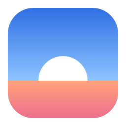
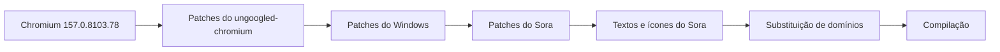

<div align="center">
  

  <h1>Sora Browser</h1>

  <p><strong>A interface do Zen Browser sobre o motor do Chromium, sem os serviços do Google.</strong></p>

  <p>
    <a href="https://github.com/jpcerchiari/sora-browser/actions/workflows/build-x64.yml"></a>
    
    
    
    <a href="LICENSE"></a>
  </p>

  <p>
    <a href="#recursos">Recursos</a> ·
    <a href="#compilação">Compilação</a> ·
    <a href="roadmap/README.md">Roadmap</a> ·
    <a href="#contribuição">Contribuição</a>
  </p>

  <p><a href="README.md">English</a> · <strong>Português</strong></p>
</div>

> [!IMPORTANT]
> O Sora está em **pré-alfa**. Todos os patches aplicam sobre o Chromium 157.0.8103.78, mas o
> projeto ainda não foi compilado e não há versões publicadas. Por enquanto, ele serve para
> acompanhar o desenvolvimento, não para uso diário.

## Sumário

- [Sobre o projeto](#sobre-o-projeto)
- [Recursos](#recursos)
- [Arquitetura](#arquitetura)
- [Compilação](#compilação)
- [Estrutura do repositório](#estrutura-do-repositório)
- [Perguntas frequentes](#perguntas-frequentes)
- [Contribuição](#contribuição)
- [Créditos](#créditos)
- [Licença](#licença)

## Sobre o projeto

O [Zen Browser](https://github.com/zen-browser/desktop) propõe uma forma de navegar mais calma e
organizada: abas verticais, página destacada da moldura, espaços de trabalho e visualização
rápida de links. Ele, porém, é construído sobre o Firefox. O Sora leva essa experiência para o
Chromium.

A base é o [ungoogled-chromium](https://github.com/ungoogled-software/ungoogled-chromium), o
Chromium sem a integração com os serviços do Google. Sobre ele, a interface do Zen foi
reescrita em C++ com o toolkit Views do Chromium, já que o código de interface do Zen (CSS, JS
e XUL) não roda no Chromium. O Zen serve, portanto, apenas como referência de design.

Um critério orienta todo o projeto: o que no Zen é identidade própria entra no Sora; o que no
Zen é apenas o comportamento padrão do Firefox continua com o padrão do Chromium.

## Recursos

Todos os recursos abaixo têm patch escrito e verificado contra o código do Chromium, e aguardam
o primeiro build para validação. A especificação visual de referência está em
[`sora/zen-spec.md`](sora/zen-spec.md).

### Interface

| Recurso | Descrição |
| --- | --- |
| Abas verticais | Ativadas por padrão, com as medidas, a tipografia e as animações do Zen. |
| Página flutuante | O conteúdo é exibido como um cartão com margem, cantos arredondados e sombra. |
| Barra única | Navegação e endereço integrados ao topo da barra lateral. |
| Paleta do Zen | Cores do Zen nos temas claro e escuro, com a cor de destaque derivada do Windows. |
| Barra de endereço | Exibe só o domínio em repouso e abre como painel flutuante pelo teclado. |
| Controles da janela | Botões de minimizar, maximizar e fechar recolhidos até o cursor se aproximar. |

### Recursos do Zen

| Recurso | Descrição |
| --- | --- |
| Workspaces | Conjuntos de abas independentes, com nome, cor e ícone, alternados por atalho. |
| Essentials | Abas fixadas exibidas em grade, compartilhadas entre os workspaces. |
| Glance | `Alt` + clique abre um link num cartão sobre a página atual, sem criar uma aba. |
| Split view | Duas abas lado a lado, cada uma no seu próprio cartão. |
| Modo compacto | A barra lateral se recolhe e reaparece como painel flutuante. |

Os itens pendentes de cada recurso estão detalhados no [roadmap](roadmap/README.md).

## Arquitetura

O repositório não contém o código do Chromium, apenas as alterações aplicadas sobre ele. O
modelo é o mesmo do ungoogled-chromium-windows: uma série ordenada de patches aplicada sobre
uma versão fixa do Chromium.



Cada patch do Sora trata de um único recurso e está descrito em
[`sora/README.md`](sora/README.md#patches), junto com os riscos conhecidos. Textos da interface
e ícones não são patches: são aplicados por ferramentas próprias, executadas pelo `build.py`.

## Compilação

A compilação segue o processo do ungoogled-chromium-windows e exige Windows, Visual Studio,
Python 3 e cerca de 100 GB livres em disco. Os pré-requisitos completos estão em
[`docs/building.md`](docs/building.md).

```powershell
git clone --recurse-submodules https://github.com/jpcerchiari/sora-browser.git
cd sora-browser
python3 build.py
python3 package.py
```

O build também pode ser executado no GitHub Actions, pelo workflow
[`build-x64`](.github/workflows/build-x64.yml). Ele divide a compilação em etapas encadeadas
para respeitar o limite de tempo dos runners e publica o resultado como artefato.

Para escrever ou alterar um patch sem baixar o código completo do Chromium, consulte o
[guia de desenvolvimento](sora/README.md#como-escrever-um-patch-sem-a-árvore-do-chromium).

## Estrutura do repositório

| Caminho | Conteúdo |
| --- | --- |
| [`patches/sora/`](patches/sora/) | Patches do Sora, aplicados na ordem de [`patches/series`](patches/series). |
| [`sora/`](sora/) | Decisões do projeto, especificação do Zen e guia de desenvolvimento. |
| [`sora/tools/`](sora/tools/) | Ferramentas para montar árvores parciais, verificar patches, trocar textos e gerar ícones. |
| [`sora/branding/`](sora/branding/) | Ícone do Sora em SVG e os arquivos gerados para o build. |
| [`roadmap/`](roadmap/) | O que já foi concluído e o que falta. |
| [`ungoogled-chromium/`](ungoogled-chromium/) | O ungoogled-chromium, como submódulo. |

## Perguntas frequentes

<details>
<summary><strong>Por que não usar o próprio Zen?</strong></summary>

O Zen é uma ótima opção para quem prefere o Firefox. O Sora existe para quem quer a mesma
experiência com o motor do Chromium, seja por compatibilidade com sites, seja por desempenho
ou preferência pessoal.
</details>

<details>
<summary><strong>Por que partir do ungoogled-chromium, e não do Chromium?</strong></summary>

O ungoogled-chromium já remove a integração com os serviços do Google e mantém essas
alterações atualizadas a cada versão. Partir dele evita refazer esse trabalho e deixa o Sora
concentrado na interface.
</details>

<details>
<summary><strong>Haverá versões para Linux e macOS?</strong></summary>

A primeira plataforma é o Windows. Os patches de interface são, em grande parte,
independentes de sistema operacional, mas outras plataformas só serão consideradas depois do
primeiro build estável.
</details>

## Contribuição

O Sora ainda está na fase de construção da base, e o primeiro build é a prioridade. Relatos de
problemas e sugestões são bem-vindos nas [issues](../../issues). Antes de propor um patch,
consulte o [roadmap](roadmap/README.md) e o [guia de desenvolvimento](sora/README.md).

## Créditos

- **[Chromium](https://www.chromium.org/)**: o motor sobre o qual o Sora é construído.
- **[ungoogled-chromium](https://github.com/ungoogled-software/ungoogled-chromium)** e
  **[ungoogled-chromium-windows](https://github.com/ungoogled-software/ungoogled-chromium-windows)**:
  a base do projeto, incluindo o histórico, os patches e as ferramentas de build.
- **[Zen Browser](https://github.com/zen-browser/desktop)**: a referência de design, de cores e
  de recursos. Nenhum código do Zen está neste repositório; se algum arquivo for incorporado,
  ele manterá a licença MPL-2.0 e o cabeçalho original.
- **[Helium](https://github.com/imputnet/helium)**: a inspiração para a organização do projeto.

## Licença

O código e os patches do Sora são distribuídos sob a licença BSD de 3 cláusulas, herdada do
ungoogled-chromium-windows. Consulte o arquivo [LICENSE](LICENSE). Conteúdos importados de
outros projetos mantêm suas licenças originais.
